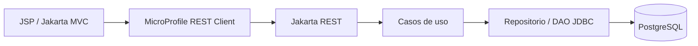

# RetroGame Catalog · Java

Catálogo e inventario de videojuegos retro con **API REST**, **PostgreSQL** y **frontend web en JSP/Jakarta MVC**. Proyecto académico de DASI de Rodrigo Cabezas Pérez, preparado para portfolio.

## Qué hace

- Listar videojuegos y consultar su ficha completa.
- Crear, editar y eliminar registros desde la API y los formularios web.
- Gestionar título, precio, stock, fecha de lanzamiento, código serial, proveedor, valoración, categoría y portada.
- Validar los datos tanto al crear como al editar; devolver 400 para entradas inválidas y 404 cuando un registro no existe.
- Proteger los formularios MVC mediante CSRF.

## Arquitectura



| Módulo | Función |
| --- | --- |
| `common` | Modelo, DTO y excepciones compartidos |
| `videojuegos-ws` | API, casos de uso, mapeos y persistencia JDBC |
| `videojuegos-web` | Listado, ficha y formularios JSP con controladores MVC |

**Tecnologías:** Java 21, Maven, Jakarta EE, Jakarta MVC, MicroProfile REST Client, PostgreSQL, MapStruct y Lombok. Se ejecuta sobre Payara Micro 7; no utiliza Quarkus.

## Ejecutar en local

Necesitas JDK 21, Maven 3.9+, Docker Compose y el JAR de Payara Micro 7 (probado con 7.2026.1).

Desde la raíz:

```sh
cp .env.example .env
# Personaliza la contraseña de desarrollo de .env; no se versiona.
set -a
. ./.env
set +a
export PAYARA_MICRO_JAR=/ruta/a/payara-micro-7.2026.1.jar

docker compose up -d --wait
mvn -B verify
sh videojuegos-ws/backend.sh
```

En otra terminal, desde la misma carpeta:

```sh
export PAYARA_MICRO_JAR=/ruta/a/payara-micro-7.2026.1.jar
sh videojuegos-web/frontend.sh
```

- **Frontend:** `http://localhost:8092/web/videojuegos`
- **API:** `http://localhost:8081/videojuegos`
- **PostgreSQL:** `localhost:55433`, base `retrogames`; el contenedor solo publica el puerto en la interfaz local.

Puedes cambiar los puertos con `API_PORT` y `WEB_PORT`. Si cambias el de la API, configura `BACKEND_URL` al iniciar el frontend. La base de datos usa `DB_URL`, `DB_USER` y `DB_PASSWORD`.

`database.sql` inicializa cuatro juegos de demostración al crear el volumen por primera vez. Para detener la base de datos conservando sus datos: `docker compose down`.

## API

| Método | Ruta | Resultado esperado |
| --- | --- | --- |
| GET | `/videojuegos` | 200, listado resumido |
| GET | `/videojuegos/{codigo}` | 200, ficha; 404 si no existe |
| POST | `/videojuegos` | 201, videojuego creado |
| PUT | `/videojuegos/{codigo}` | 204, videojuego actualizado |
| DELETE | `/videojuegos/{codigo}` | 204, videojuego eliminado |

Ejemplo de cuerpo para crear o editar:

```json
{
  "titulo": "Demo Retro RPG",
  "precio": 24.99,
  "stock": 3,
  "fechaLanzamiento": "2005-04-30",
  "codigoSerial": "TST-2026-EUR",
  "correoProveedor": "demo@example.com",
  "valoracion": 8.5,
  "categoria": "RPG",
  "urlImagen": "https://example.com/cover.png"
}
```

En el formulario web, usa el separador decimal de la configuración regional del servidor (coma en español). Las fechas se introducen como `AAAA-MM-DD`.

Categorías: `PLATAFORMAS`, `RPG`, `ACCION` y `AVENTURA`. Las portadas deben utilizar HTTP o HTTPS.

## Pruebas

```sh
mvn -B verify
# Con la API y su base de datos local arrancadas:
python3 tests/smoke_api.py
```

La prueba de integración crea su propio registro y lo elimina al finalizar. Comprueba CRUD, 404, validación en POST/PUT y que una edición rechazada no modifique los datos. `API_URL` permite cambiar el destino de prueba.

## Alcance y contexto

La interfaz conserva el diseño sencillo de la práctica: tablas, fichas y formularios. No hay carrito, pagos, registro de usuarios ni autenticación/autorización. Es una demo local de gestión de catálogo; no debe exponerse como panel administrativo público.

Los correos de muestra usan `example.com`. Las portadas originales se cargan desde URLs externas y pueden dejar de estar disponibles; los videojuegos, sus marcas y sus imágenes pertenecen a sus respectivos titulares.

Se conserva el trabajo académico original. La preparación del repositorio, configuración externa, refuerzo de validación, escape de contenido HTML, documentación y comprobaciones se han realizado con asistencia de IA.
